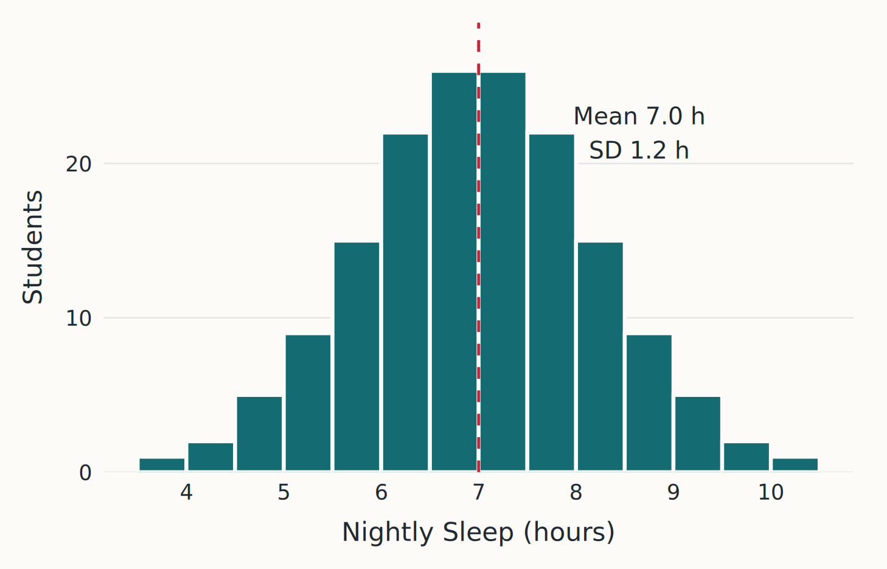
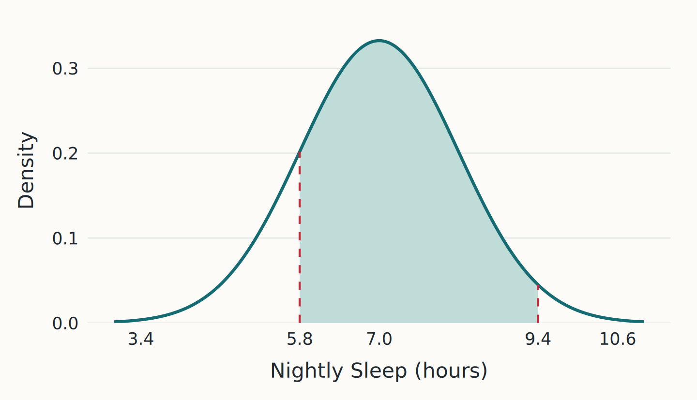
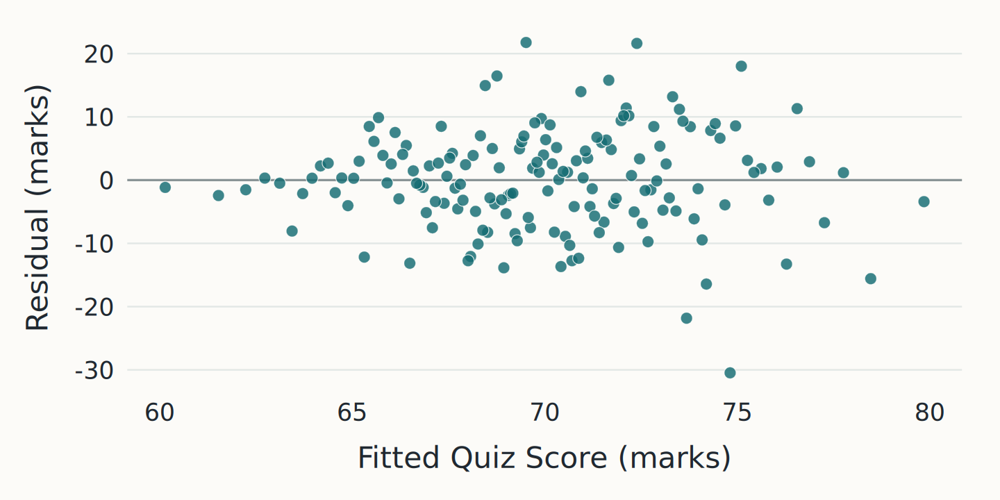
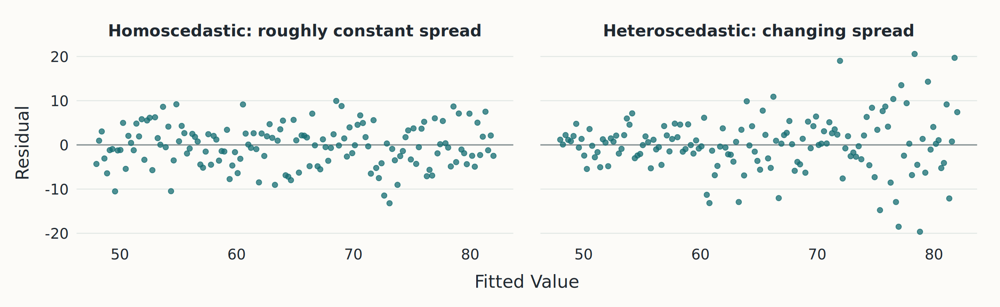
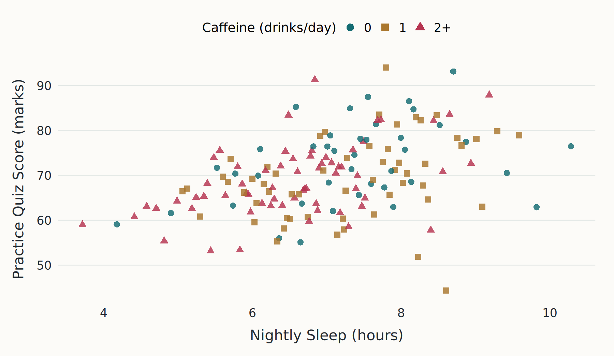
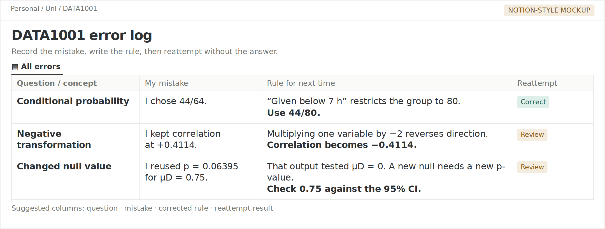
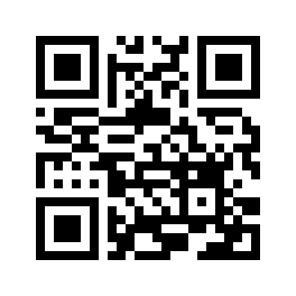

## DATA1x01<br>Final exam revision {#s1 .title-slide}

**Bodhi McNally**  
DATA1x01 Tutor

Tuesday 10 November 2026



<div id="audience-join" class="audience-join" hidden><strong>Join the live questions</strong><div class="join-qr"></div><p>Scan once. Your phone follows each question.</p></div>

::: {.societies}
::: {.society}


Sydney University Artificial Intelligence Association
:::
::: {.society}


Sydney University Data Society
:::
::: {.society}


University of Sydney Statistics Society
:::
:::

## Before we start {#s2 }

::: {.exam-stats}
::: {.exam-stat}
**30 MCQs**  
75% of the exam
:::
::: {.exam-stat}
**Extended answer**  
25% of the exam
:::
::: {.exam-stat}
**120 minutes**  
Plus 10 minutes reading
:::
:::

Closed book. No calculators. Exam Guide supplied.

We will work through 13 MCQs and three short-answer tasks. Have a go before looking at the answers.

::: {.independence}
Prepared by Bodhi McNally for this student society event. These supplementary materials are not affiliated with or endorsed by the official DATA1x01 teaching team or the University of Sydney.
:::

<footer class="slide-source"><a href="https://canvas.sydney.edu.au/courses/74355/pages/getting-ready-for-the-exam">Current exam preparation and sample paper</a> · Semester 2, 2026</footer>

## Sleep, caffeine and quiz scores {#s3 }

::: {.two-col}
::: {}
An evening study-space QR invitation recruits **160 first-year volunteers**.

Students report their usual sleep and caffeine intake, then complete the same practice quiz.

Nobody assigns how much they sleep.

[Simulated data for these questions.]{.small .muted}
:::
::: {.chart}

:::
:::

<footer class="slide-source">Module 1 Exploring Data · <a href="https://canvas.sydney.edu.au/courses/74355/files/51727941">Topic 1</a> · <a href="https://canvas.sydney.edu.au/courses/74355/files/51861327">Topic 2</a> · <a href="https://canvas.sydney.edu.au/courses/74355/files/51979272">Topic 3</a> · LO2 / LO3</footer>

## The variables {#s4 .dictionary}

| Variable | Description | Type |
|---|---|---|
| `StudentID` | Anonymous student identifier | Identifier |
| `Sleep` | Average nightly sleep over 14 days, in hours | Quantitative |
| `Score` | Practice quiz score, out of 100 | Quantitative |
| `Caffeine` | Drinks per day: 0, 1 or 2+ | Qualitative, ordinal |
| `SleepGroup` | Below 7 h or at least 7 h | Qualitative |

One row represents **one student**. In the R examples, the data frame is called `students` and caffeine category is a factor.

<footer class="slide-source">Module 1 Exploring Data · <a href="https://canvas.sydney.edu.au/courses/74355/files/51861327">Topic 2</a> · LO3</footer>

## Q1  Study design {#q1 .mcq }

::: {.poll .mcq-vote-header #vote-q1 results="hidden" prompt="Q1. An evening study-space QR invitation recruits 160 first-year volunteers. They report their sleep and complete a common quiz. Which statement is most appropriate?"}
- [ ] A larger sample would remove the recruitment bias.
- [ ] Volunteering makes the study a randomised experiment.
- [x] The study can identify associations, subject to recruitment limits.
- [ ] Using the same quiz makes the sample representative.
:::

::: {.mcq-layout}
::: {.question-panel}
An evening study-space QR invitation recruits 160 first-year volunteers. They report their sleep and complete a common quiz. **Which statement is most appropriate?**

> Sleep is measured, not assigned.
:::

::: {.choices}
::: {.answer-row data-correct="false" data-option="A"}
::: {.choice-line}
<button class="choice-letter" aria-label="Select option A">A</button>
::: {.option-text}
A larger sample would remove the recruitment bias.
:::
:::
::: {.answer-reason .fragment data-fragment-index="0"}
**Incorrect.** More observations reduce chance variation, not systematic selection bias.
:::
:::

::: {.answer-row data-correct="false" data-option="B"}
::: {.choice-line}
<button class="choice-letter" aria-label="Select option B">B</button>
::: {.option-text}
Volunteering makes the study a randomised experiment.
:::
:::
::: {.answer-reason .fragment data-fragment-index="0"}
**Incorrect.** Random allocation of a treatment defines a randomised experiment.
:::
:::

::: {.answer-row data-correct="true" data-option="C"}
::: {.choice-line}
<button class="choice-letter" aria-label="Select option C">C</button>
::: {.option-text}
The study can identify associations, subject to recruitment limits.
:::
:::
::: {.answer-reason .fragment data-fragment-index="0"}
**Correct.** Sleep is observed. Selection bias and confounding remain possible.
:::
:::

::: {.answer-row data-correct="false" data-option="D"}
::: {.choice-line}
<button class="choice-letter" aria-label="Select option D">D</button>
::: {.option-text}
Using the same quiz makes the sample representative.
:::
:::
::: {.answer-reason .fragment data-fragment-index="0"}
**Incorrect.** A common measurement does not change how students were recruited.
:::
:::

:::
:::


<footer class="slide-source">Module 1 Exploring Data / Module 3 Sampling Data · <a href="https://canvas.sydney.edu.au/courses/74355/files/51727941">Topic 1</a> · <a href="https://canvas.sydney.edu.au/courses/74355/files/52698399">Topic 8</a> · LO2 / LO9</footer>

## Study design and generalisation {#s6 .core}

| Feature of the design | What it supports |
|---|---|
| Random sampling from a population | Generalising to that population, subject to the design |
| Random allocation to treatment groups | Comparing causal treatment effects, subject to the experiment |
| Observational data | Describing associations, with possible confounding |

In this study, evening volunteers may differ from other students. Workload could also affect both sleep and quiz performance.

**A bigger convenience sample can still be biased.**

<footer class="slide-source">Module 1 Exploring Data / Module 3 Sampling Data · <a href="https://canvas.sydney.edu.au/courses/74355/files/51727941">Topic 1</a> · <a href="https://canvas.sydney.edu.au/courses/74355/files/52698399">Topic 8</a> · LO2 / LO9</footer>

## Q2  Linking student records {#q2 .mcq }

::: {.poll .mcq-vote-header #vote-q2 results="hidden" prompt="Q2. A researcher wants to link the sleep survey to individual university marks. The original consent covered only the survey. Which action is most appropriate before linking the records?"}
- [ ] Remove names, then link records without checking consent.
- [ ] Publish the linked records after replacing student numbers.
- [ ] Assume a larger dataset makes privacy concerns negligible.
- [x] Check consent and ethics requirements, then limit and secure the data.
:::

::: {.mcq-layout}
::: {.question-panel}
A researcher wants to link the sleep survey to individual university marks. The original consent covered only the survey. **Which action is most appropriate before linking the records?**


:::

::: {.choices}
::: {.answer-row data-correct="false" data-option="A"}
::: {.choice-line}
<button class="choice-letter" aria-label="Select option A">A</button>
::: {.option-text}
Remove names, then link records without checking consent.
:::
:::
::: {.answer-reason .fragment data-fragment-index="0"}
**Incorrect.** Removing names alone does not resolve consent or re-identification risks.
:::
:::

::: {.answer-row data-correct="false" data-option="B"}
::: {.choice-line}
<button class="choice-letter" aria-label="Select option B">B</button>
::: {.option-text}
Publish the linked records after replacing student numbers.
:::
:::
::: {.answer-reason .fragment data-fragment-index="0"}
**Incorrect.** Replacing an identifier does not necessarily make linked records anonymous.
:::
:::

::: {.answer-row data-correct="false" data-option="C"}
::: {.choice-line}
<button class="choice-letter" aria-label="Select option C">C</button>
::: {.option-text}
Assume a larger dataset makes privacy concerns negligible.
:::
:::
::: {.answer-reason .fragment data-fragment-index="0"}
**Incorrect.** More data can increase the risk of identifying an individual.
:::
:::

::: {.answer-row data-correct="true" data-option="D"}
::: {.choice-line}
<button class="choice-letter" aria-label="Select option D">D</button>
::: {.option-text}
Check consent and ethics requirements, then limit and secure the data.
:::
:::
::: {.answer-reason .fragment data-fragment-index="0"}
**Correct.** Check the new use, minimise the linked data and protect access.
:::
:::

:::
:::


<footer class="slide-source">Module 1 Exploring Data · <a href="https://canvas.sydney.edu.au/courses/74355/files/51727941">Topic 1</a> · LO1</footer>

## Q3  Transforming variables {#q3 .mcq }

::: {.poll .mcq-vote-header #vote-q3 results="hidden" prompt="Q3. The following summaries describe the 160 students. A new variable is defined in R. What are its mean, SD and correlation with Score? Refer to the code, plot or table on the presentation."}
- [x] Mean −4, SD 2.4, correlation −0.4114.
- [ ] Mean −4, SD 1.2, correlation −0.4114.
- [ ] Mean −4, SD 2.4, correlation +0.4114.
- [ ] Mean +4, SD 2.4, correlation −0.4114.
:::

::: {.mcq-layout}
::: {.question-panel}
The following summaries describe the 160 students. A new variable is defined in R. **What are its mean, SD and correlation with Score?**

```text
mean(Sleep)          7.0
sd(Sleep)            1.2
cor(Sleep, Score)    0.4114
```

```r
SleepIndex = 10 - 2 * students$Sleep
```
:::

::: {.choices}
::: {.answer-row data-correct="true" data-option="A"}
::: {.choice-line}
<button class="choice-letter" aria-label="Select option A">A</button>
::: {.option-text}
Mean −4, SD 2.4, correlation −0.4114.
:::
:::
::: {.answer-reason .fragment data-fragment-index="0"}
**Correct.** 10 − 2×7 = −4. SD is multiplied by 2 and correlation changes sign.
:::
:::

::: {.answer-row data-correct="false" data-option="B"}
::: {.choice-line}
<button class="choice-letter" aria-label="Select option B">B</button>
::: {.option-text}
Mean −4, SD 1.2, correlation −0.4114.
:::
:::
::: {.answer-reason .fragment data-fragment-index="0"}
**Incorrect.** Multiplication by −2 doubles the SD.
:::
:::

::: {.answer-row data-correct="false" data-option="C"}
::: {.choice-line}
<button class="choice-letter" aria-label="Select option C">C</button>
::: {.option-text}
Mean −4, SD 2.4, correlation +0.4114.
:::
:::
::: {.answer-reason .fragment data-fragment-index="0"}
**Incorrect.** Reversing the direction of Sleep changes the correlation’s sign.
:::
:::

::: {.answer-row data-correct="false" data-option="D"}
::: {.choice-line}
<button class="choice-letter" aria-label="Select option D">D</button>
::: {.option-text}
Mean +4, SD 2.4, correlation −0.4114.
:::
:::
::: {.answer-reason .fragment data-fragment-index="0"}
**Incorrect.** The transformed mean is 10 − 14 = −4.
:::
:::

:::
:::


<footer class="slide-source">Module 1 Exploring Data / Module 2 Modelling Data · <a href="https://canvas.sydney.edu.au/courses/74355/files/51979272">Topic 3</a> · <a href="https://canvas.sydney.edu.au/courses/74355/files/52235105">Topic 5</a> · LO3 / LO5</footer>

## Transformations: mean, SD and correlation {#s8 .core}

For $W=a+bX$:

| Summary | Transformation |
|---|---|
| Mean | $\bar{W}=a+b\bar{X}$ |
| Standard deviation | $s_W=\lvert b\rvert s_X$ |
| Correlation with Y | Same magnitude. The sign reverses if $b<0$. |

For `SleepIndex = 10 - 2 * students$Sleep`:

$$\overline{\text{SleepIndex}}=-4,\qquad s_{\text{SleepIndex}}=2.4,\qquad r=-0.4114.$$

[Adding a constant does not change spread or correlation. If b = 0, the transformed variable is constant and its correlation is undefined.]{.small}

<footer class="slide-source">Module 1 Exploring Data / Module 2 Modelling Data · <a href="https://canvas.sydney.edu.au/courses/74355/files/51979272">Topic 3</a> · <a href="https://canvas.sydney.edu.au/courses/74355/files/52235105">Topic 5</a> · LO3 / LO5</footer>

## Q4  Normal probabilities in R {#q4 .mcq .code-choices}

::: {.poll .mcq-vote-header #vote-q4 results="hidden" prompt="Q4. Assume X~ N(7,1.2^2) models nightly sleep. Which R expression calculates P(5.8<X<9.4)? Refer to the code, plot or table on the presentation."}
- [ ] `pnorm(9.4,7,1.2^2)-pnorm(5.8,7,1.2^2)`
- [ ] `pnorm(5.8,7,1.2)-pnorm(9.4,7,1.2)`
- [ ] `1-pnorm(9.4,7,1.2)+pnorm(5.8,7,1.2)`
- [x] `pnorm(9.4,7,1.2)-pnorm(5.8,7,1.2)`
:::

::: {.mcq-layout}
::: {.question-panel}
Assume $X\sim N(7,1.2^2)$ models nightly sleep. **Which R expression calculates $P(5.8<X<9.4)$?**


:::

::: {.choices}
::: {.answer-row data-correct="false" data-option="A"}
::: {.choice-line}
<button class="choice-letter" aria-label="Select option A">A</button>
::: {.option-text}
`pnorm(9.4,7,1.2^2)-pnorm(5.8,7,1.2^2)`
:::
:::
::: {.answer-reason .fragment data-fragment-index="0"}
**Incorrect.** The third argument of pnorm is the SD, not the variance.
:::
:::

::: {.answer-row data-correct="false" data-option="B"}
::: {.choice-line}
<button class="choice-letter" aria-label="Select option B">B</button>
::: {.option-text}
`pnorm(5.8,7,1.2)-pnorm(9.4,7,1.2)`
:::
:::
::: {.answer-reason .fragment data-fragment-index="0"}
**Incorrect.** The subtraction is reversed, giving a negative number.
:::
:::

::: {.answer-row data-correct="false" data-option="C"}
::: {.choice-line}
<button class="choice-letter" aria-label="Select option C">C</button>
::: {.option-text}
`1-pnorm(9.4,7,1.2)+pnorm(5.8,7,1.2)`
:::
:::
::: {.answer-reason .fragment data-fragment-index="0"}
**Incorrect.** This adds the two tails outside the required interval.
:::
:::

::: {.answer-row data-correct="true" data-option="D"}
::: {.choice-line}
<button class="choice-letter" aria-label="Select option D">D</button>
::: {.option-text}
`pnorm(9.4,7,1.2)-pnorm(5.8,7,1.2)`
:::
:::
::: {.answer-reason .fragment data-fragment-index="0"}
**Correct.** Subtract the lower-tail area at 5.8 from the area at 9.4.
:::
:::

:::
:::


<footer class="slide-source">Module 2 Modelling Data · <a href="https://canvas.sydney.edu.au/courses/74355/files/52038771">Topic 4</a> · LO4</footer>

## Normal notation and R {#s10 .core}

::: {.two-col}
::: {}
**Course notation**

$$X\sim N(\mu,\sigma^2)$$

The second parameter is the variance.

$$Z=\frac{X-\mu}{\sigma}$$
:::
::: {}
**R functions**

```r
pnorm(x, mean, sd)
qnorm(p, mean, sd)
```

`pnorm` returns a lower-tail probability. `qnorm` returns a quantile.
:::
:::

$$P(5.8<X<9.4)=P(-1<Z<2)=0.8186.$$

[The 68–95 rule gives approximately 81.5%.]{.small}

<footer class="slide-source">Module 2 Modelling Data · <a href="https://canvas.sydney.edu.au/courses/74355/files/52038771">Topic 4</a> · LO4</footer>

## Q5  Measurement error {#q5 .mcq }

::: {.poll .mcq-vote-header #vote-q5 results="hidden" prompt="Q5. A tracker measures the same fixed duration 36 times under the same conditions. Each reading has a bias of +20 minutes and an independent chance error with mean 0 and SD 12 minutes. For the average of the 36 readings, what are the bias and SE?"}
- [ ] Bias 0 minutes, SE 2 minutes.
- [ ] Bias +20 minutes, SE 12 minutes.
- [x] Bias +20 minutes, SE 2 minutes.
- [ ] Bias +20/36 minutes, SE 12/36 minutes.
:::

::: {.mcq-layout}
::: {.question-panel}
A tracker measures the **same fixed duration** 36 times under the same conditions. Each reading has a bias of +20 minutes and an independent chance error with mean 0 and SD 12 minutes. **For the average of the 36 readings, what are the bias and SE?**


:::

::: {.choices}
::: {.answer-row data-correct="false" data-option="A"}
::: {.choice-line}
<button class="choice-letter" aria-label="Select option A">A</button>
::: {.option-text}
Bias 0 minutes, SE 2 minutes.
:::
:::
::: {.answer-reason .fragment data-fragment-index="0"}
**Incorrect.** Averaging reduces chance error. The common +20 minute bias remains.
:::
:::

::: {.answer-row data-correct="false" data-option="B"}
::: {.choice-line}
<button class="choice-letter" aria-label="Select option B">B</button>
::: {.option-text}
Bias +20 minutes, SE 12 minutes.
:::
:::
::: {.answer-reason .fragment data-fragment-index="0"}
**Incorrect.** The spread of the average is smaller than the spread of one reading.
:::
:::

::: {.answer-row data-correct="true" data-option="C"}
::: {.choice-line}
<button class="choice-letter" aria-label="Select option C">C</button>
::: {.option-text}
Bias +20 minutes, SE 2 minutes.
:::
:::
::: {.answer-reason .fragment data-fragment-index="0"}
**Correct.** Bias remains +20. The SE is 12 / sqrt(36) = 2 minutes.
:::
:::

::: {.answer-row data-correct="false" data-option="D"}
::: {.choice-line}
<button class="choice-letter" aria-label="Select option D">D</button>
::: {.option-text}
Bias +20/36 minutes, SE 12/36 minutes.
:::
:::
::: {.answer-reason .fragment data-fragment-index="0"}
**Incorrect.** The fixed bias remains. SE is divided by sqrt(36), not 36.
:::
:::

:::
:::


<footer class="slide-source">Module 2 Modelling Data / Module 3 Sampling Data · <a href="https://canvas.sydney.edu.au/courses/74355/files/52038771">Topic 4</a> · <a href="https://canvas.sydney.edu.au/courses/74355/files/52560039">Topic 7</a> · LO4 / LO6</footer>

## Measurement error and averaging {#measurement-core .core}

$$\text{Measurement}=\text{exact value}+\text{bias}+\text{chance error}.$$

| Component | Averaging n independent readings |
|---|---|
| Fixed bias | Remains in the average |
| Chance error, mean 0 and SD σ | Average has SE = σ / √n |

::: {.callout-note title="Repeated readings"}
Repeating the same measurement under the same conditions helps estimate chance-error spread. Averaging improves precision, but a fixed calibration error remains.
:::

For the tracker: **bias +20 minutes, SE 2 minutes**.


<footer class="slide-source">Module 2 Modelling Data / Module 3 Sampling Data · <a href="https://canvas.sydney.edu.au/courses/74355/files/52038771">Topic 4</a> · <a href="https://canvas.sydney.edu.au/courses/74355/files/52560039">Topic 7</a> · LO4 / LO6</footer>

## Q6  Conditional probability {#q6 .mcq }

::: {.poll .mcq-vote-header #vote-q6 results="hidden" prompt="Q6. R gives the following counts. One student is chosen at random from those sleeping below 7 hours. What is the probability they report 2+ caffeinated drinks per day? Refer to the code, plot or table on the presentation."}
- [ ] 44/64
- [x] 44/80
- [ ] 44/160
- [ ] 64/160
:::

::: {.mcq-layout}
::: {.question-panel}
R gives the following counts. One student is chosen at random **from those sleeping below 7 hours**. What is the probability they report 2+ caffeinated drinks per day?

```r
table(students$SleepGroup,
      students$Caffeine)
```

| Sleep group | 0 | 1 | 2+ | Total |
|---|---:|---:|---:|---:|
| Below 7 h | 12 | 24 | 44 | 80 |
| At least 7 h | 28 | 32 | 20 | 80 |
| Total | 40 | 56 | 64 | 160 |
:::

::: {.choices}
::: {.answer-row data-correct="false" data-option="A"}
::: {.choice-line}
<button class="choice-letter" aria-label="Select option A">A</button>
::: {.option-text}
44/64
:::
:::
::: {.answer-reason .fragment data-fragment-index="0"}
**Incorrect.** This conditions on 2+ drinks rather than short sleep.
:::
:::

::: {.answer-row data-correct="true" data-option="B"}
::: {.choice-line}
<button class="choice-letter" aria-label="Select option B">B</button>
::: {.option-text}
44/80
:::
:::
::: {.answer-reason .fragment data-fragment-index="0"}
**Correct.** The relevant group contains 80 students, of whom 44 report 2+ drinks.
:::
:::

::: {.answer-row data-correct="false" data-option="C"}
::: {.choice-line}
<button class="choice-letter" aria-label="Select option C">C</button>
::: {.option-text}
44/160
:::
:::
::: {.answer-reason .fragment data-fragment-index="0"}
**Incorrect.** This is the joint probability among all 160 students.
:::
:::

::: {.answer-row data-correct="false" data-option="D"}
::: {.choice-line}
<button class="choice-letter" aria-label="Select option D">D</button>
::: {.option-text}
64/160
:::
:::
::: {.answer-reason .fragment data-fragment-index="0"}
**Incorrect.** This is the marginal probability of 2+ drinks.
:::
:::

:::
:::


<footer class="slide-source">Module 3 Sampling Data · <a href="https://canvas.sydney.edu.au/courses/74355/files/52560030">Topic 6</a> · LO6</footer>

## Q7  Binomial probability in R {#q7 .mcq .code-choices}

::: {.poll .mcq-vote-header #vote-q7 results="hidden" prompt="Q7. A box model has a 0.4 chance of a 2+ drinks ticket. Five tickets are drawn independently with replacement. Let X count the 2+ tickets. Which R expression gives the chance of at least two? Refer to the code, plot or table on the presentation."}
- [x] `1 - pbinom(1, 5, 0.4)`
- [ ] `1 - pbinom(2, 5, 0.4)`
- [ ] `dbinom(2, 5, 0.4)`
- [ ] `pbinom(2, 5, 0.4)`
:::

::: {.mcq-layout}
::: {.question-panel}
A box model has a 0.4 chance of a 2+ drinks ticket. Five tickets are drawn independently with replacement. Let X count the 2+ tickets. **Which R expression gives the chance of at least two?**

```r
# X ~ Binomial(size = 5, prob = 0.4)
```
:::

::: {.choices}
::: {.answer-row data-correct="true" data-option="A"}
::: {.choice-line}
<button class="choice-letter" aria-label="Select option A">A</button>
::: {.option-text}
`1 - pbinom(1, 5, 0.4)`
:::
:::
::: {.answer-reason .fragment data-fragment-index="0"}
**Correct.** At least two is the complement of zero or one.
:::
:::

::: {.answer-row data-correct="false" data-option="B"}
::: {.choice-line}
<button class="choice-letter" aria-label="Select option B">B</button>
::: {.option-text}
`1 - pbinom(2, 5, 0.4)`
:::
:::
::: {.answer-reason .fragment data-fragment-index="0"}
**Incorrect.** This gives more than two, so it excludes X = 2.
:::
:::

::: {.answer-row data-correct="false" data-option="C"}
::: {.choice-line}
<button class="choice-letter" aria-label="Select option C">C</button>
::: {.option-text}
`dbinom(2, 5, 0.4)`
:::
:::
::: {.answer-reason .fragment data-fragment-index="0"}
**Incorrect.** This gives exactly two.
:::
:::

::: {.answer-row data-correct="false" data-option="D"}
::: {.choice-line}
<button class="choice-letter" aria-label="Select option D">D</button>
::: {.option-text}
`pbinom(2, 5, 0.4)`
:::
:::
::: {.answer-reason .fragment data-fragment-index="0"}
**Incorrect.** This gives at most two.
:::
:::

:::
:::


<footer class="slide-source">Module 3 Sampling Data · <a href="https://canvas.sydney.edu.au/courses/74355/files/52560030">Topic 6</a> · LO6</footer>

## Q8  Sampling distributions {#q8 .mcq }

::: {.poll .mcq-vote-header #vote-q8 results="hidden" prompt="Q8. A population has mean sleep 7 hours and SD 1.2 hours. Independent observations are sampled with replacement. What are the EV and SE of the sample mean when n increases from 25 to 100?"}
- [ ] EV 7 hours, SE 0.06 hours.
- [ ] EV 7 hours, SE 0.48 hours.
- [ ] EV 28 hours, SE 0.12 hours.
- [x] EV 7 hours, SE 0.12 hours.
:::

::: {.mcq-layout}
::: {.question-panel}
A population has mean sleep **7 hours** and SD **1.2 hours**. Independent observations are sampled with replacement. **What are the EV and SE of the sample mean when n increases from 25 to 100?**

For $n=25$, $EV(\bar{X})=7$ and $SE(\bar{X})=0.24$.
:::

::: {.choices}
::: {.answer-row data-correct="false" data-option="A"}
::: {.choice-line}
<button class="choice-letter" aria-label="Select option A">A</button>
::: {.option-text}
EV 7 hours, SE 0.06 hours.
:::
:::
::: {.answer-reason .fragment data-fragment-index="0"}
**Incorrect.** SE scales with $1/\sqrt n$, not $1/n$.
:::
:::

::: {.answer-row data-correct="false" data-option="B"}
::: {.choice-line}
<button class="choice-letter" aria-label="Select option B">B</button>
::: {.option-text}
EV 7 hours, SE 0.48 hours.
:::
:::
::: {.answer-reason .fragment data-fragment-index="0"}
**Incorrect.** A larger sample reduces the SE.
:::
:::

::: {.answer-row data-correct="false" data-option="C"}
::: {.choice-line}
<button class="choice-letter" aria-label="Select option C">C</button>
::: {.option-text}
EV 28 hours, SE 0.12 hours.
:::
:::
::: {.answer-reason .fragment data-fragment-index="0"}
**Incorrect.** The EV of a sample mean remains the population mean.
:::
:::

::: {.answer-row data-correct="true" data-option="D"}
::: {.choice-line}
<button class="choice-letter" aria-label="Select option D">D</button>
::: {.option-text}
EV 7 hours, SE 0.12 hours.
:::
:::
::: {.answer-reason .fragment data-fragment-index="0"}
**Correct.** $SE=1.2/\sqrt{100}=0.12$. Four times n gives half the SE.
:::
:::

:::
:::


<footer class="slide-source">Module 3 Sampling Data · <a href="https://canvas.sydney.edu.au/courses/74355/files/52560039">Topic 7</a> · LO6</footer>

## Sample size and standard error {#s13 .core}

::: {.two-col .sampling-layout}
::: {}
$$EV(\bar{X})=\mu,\qquad SE(\bar{X})=\frac{\sigma}{\sqrt n}.$$

The population mean and SD stay fixed. Increasing n reduces the spread of sample means.

```r
SE = 1.2 / sqrt(n)
```

More simulation **replicates** make a histogram smoother. They do not change this theoretical SE.
:::
::: {.live-widget data-shiny-widget="sampling"}
::: {.sampling-demo .offline-widget}
<div class="sample-buttons" aria-label="Choose sample size"><button type="button" data-n="25" aria-pressed="true">n = 25</button><button type="button" data-n="100" aria-pressed="false">n = 100</button><button type="button" data-n="400" aria-pressed="false">n = 400</button></div>
<svg id="sampling-plot" viewBox="0 0 560 320" role="img" aria-label="Sampling distribution of the mean under a Normal population model"><path id="sampling-fill"></path><path id="sampling-curve"></path><line x1="36" y1="270" x2="534" y2="270" stroke="#718087"></line><g id="sampling-ticks"></g><text x="280" y="317" text-anchor="middle">Sample Mean Sleep (hours)</text></svg>
<p id="sampling-summary" aria-live="polite"></p>

[Graph assumes a Normal population with mean 7 and SD 1.2.]{.tiny .muted}
:::
:::
:::


<footer class="slide-source">Module 3 Sampling Data · <a href="https://canvas.sydney.edu.au/courses/74355/files/52560039">Topic 7</a> · LO6</footer>

## Q9  Bootstrapping the mean {#q9 .mcq .code-choices}

::: {.poll .mcq-vote-header #vote-q9 results="hidden" prompt="Q9. The observed survey has 160 complete Sleep values. We want a bootstrap distribution of the mean. Which expression should replace RESAMPLE? Refer to the code, plot or table on the presentation."}
- [ ] `sample(students$Sleep, 160, replace=FALSE)`
- [x] `sample(students$Sleep, 160, replace=TRUE)`
- [ ] `rnorm(160, mean=7, sd=1.2)`
- [ ] `sample(students$Sleep, 10000, replace=TRUE)`
:::

::: {.mcq-layout}
::: {.question-panel}
The observed survey has 160 complete Sleep values. We want a bootstrap distribution of the mean. **Which expression should replace RESAMPLE?**

```r
replicate(10000, {
  x = RESAMPLE
  mean(x)
})
```
:::

::: {.choices}
::: {.answer-row data-correct="false" data-option="A"}
::: {.choice-line}
<button class="choice-letter" aria-label="Select option A">A</button>
::: {.option-text}
`sample(students$Sleep, 160, replace=FALSE)`
:::
:::
::: {.answer-reason .fragment data-fragment-index="0"}
**Incorrect.** Without replacement, every value appears once. Each mean is unchanged.
:::
:::

::: {.answer-row data-correct="true" data-option="B"}
::: {.choice-line}
<button class="choice-letter" aria-label="Select option B">B</button>
::: {.option-text}
`sample(students$Sleep, 160, replace=TRUE)`
:::
:::
::: {.answer-reason .fragment data-fragment-index="0"}
**Correct.** Each bootstrap sample has the original size and resamples the observed values with replacement.
:::
:::

::: {.answer-row data-correct="false" data-option="C"}
::: {.choice-line}
<button class="choice-letter" aria-label="Select option C">C</button>
::: {.option-text}
`rnorm(160, mean=7, sd=1.2)`
:::
:::
::: {.answer-reason .fragment data-fragment-index="0"}
**Incorrect.** This simulates from a Normal model rather than resampling the observed data.
:::
:::

::: {.answer-row data-correct="false" data-option="D"}
::: {.choice-line}
<button class="choice-letter" aria-label="Select option D">D</button>
::: {.option-text}
`sample(students$Sleep, 10000, replace=TRUE)`
:::
:::
::: {.answer-reason .fragment data-fragment-index="0"}
**Incorrect.** 10,000 is the number of replicates. Each resample should still contain 160 values.
:::
:::

:::
:::


<footer class="slide-source">Module 3 Sampling Data · <a href="https://canvas.sydney.edu.au/courses/74355/files/52698399">Topic 8</a> · LO6</footer>

## Bootstrap samples and simulation replicates {#bootstrap-core .core}

```r
set.seed(1001)
boot_means = replicate(10000, {
  x = sample(students$Sleep, 160, replace = TRUE)
  mean(x)
})
sd(boot_means)  # bootstrap estimate of the mean's SE
```

| Number | Role |
|---|---|
| 160 | Observations in each bootstrap sample |
| 10,000 | Repeated resamples used to approximate the distribution |

Resampling a convenience sample does not repair its recruitment bias.


<footer class="slide-source">Module 3 Sampling Data · <a href="https://canvas.sydney.edu.au/courses/74355/files/52698399">Topic 8</a> · LO6 / LO9</footer>

## Q10  Using a confidence interval {#q10 .mcq .paired-question}

::: {.poll .mcq-vote-header #vote-q10 results="hidden" prompt="Q10. Sixteen students are measured before and after a phone-free fortnight. Let D=After-Before. Assume independent students and approximately Normal differences. For the new two-sided test H₀:μD=0.75 at 5%, which conclusion is correct? Refer to the code, plot or table on the presentation."}
- [ ] Reject: the sample mean differs from 0.75.
- [x] Retain: 0.75 lies inside the 95% confidence interval.
- [ ] Retain: the new p-value is 0.06395.
- [ ] Accept: there is a 95% probability the mean lies in this interval.
:::

::: {.mcq-layout}
::: {.question-panel}
Sixteen students are measured before and after a phone-free fortnight. Let $D=\text{After}-\text{Before}$. Assume independent students and approximately Normal differences. **For the new two-sided test $H_0:\mu_D=0.75$ at 5%, which conclusion is correct?**

```r
t.test(D, mu = 0)
```

```text
t = 2, df = 15, p-value = 0.06395
95 percent confidence interval:
 -0.03286  1.03286
sample mean: 0.5
```
:::

::: {.choices}
::: {.answer-row data-correct="false" data-option="A"}
::: {.choice-line}
<button class="choice-letter" aria-label="Select option A">A</button>
::: {.option-text}
Reject: the sample mean differs from 0.75.
:::
:::
::: {.answer-reason .fragment data-fragment-index="0"}
**Incorrect.** A sample estimate can differ from the null through chance variation.
:::
:::

::: {.answer-row data-correct="true" data-option="B"}
::: {.choice-line}
<button class="choice-letter" aria-label="Select option B">B</button>
::: {.option-text}
Retain: 0.75 lies inside the 95% confidence interval.
:::
:::
::: {.answer-reason .fragment data-fragment-index="0"}
**Correct.** A matching two-sided 5% test retains null values inside the 95% CI.
:::
:::

::: {.answer-row data-correct="false" data-option="C"}
::: {.choice-line}
<button class="choice-letter" aria-label="Select option C">C</button>
::: {.option-text}
Retain: the new p-value is 0.06395.
:::
:::
::: {.answer-reason .fragment data-fragment-index="0"}
**Incorrect.** The printed p-value tests μD = 0. The new p-value is 0.3332.
:::
:::

::: {.answer-row data-correct="false" data-option="D"}
::: {.choice-line}
<button class="choice-letter" aria-label="Select option D">D</button>
::: {.option-text}
Accept: there is a 95% probability the mean lies in this interval.
:::
:::
::: {.answer-reason .fragment data-fragment-index="0"}
**Incorrect.** The parameter is fixed. 95% refers to the CI method’s long-run coverage.
:::
:::

:::
:::


<footer class="slide-source">Module 3 Sampling Data / Module 4 Decisions with Data · <a href="https://canvas.sydney.edu.au/courses/74355/files/52698399">Topic 8</a> · <a href="https://canvas.sydney.edu.au/courses/74355/files/53263090">Topic 10</a> · LO7 / LO8</footer>

## Paired data and the null value {#s15 .core}

::: {.two-col .paired-core-layout}
::: {}
Each student is measured twice. Analyse the **within-student differences**.

$$t=\frac{\bar{D}-\mu_0}{s_D/\sqrt n},\qquad df=n-1.$$

Here, mean D = 0.5 and SE = 0.25.

```r
t.test(D, mu = 0.75)
```

The interval stays fixed when the null changes. The test statistic and p-value change.
:::
::: {.live-widget data-shiny-widget="ci"}
<div class="offline-widget ci-demo">
<p class="widget-prompt">Change the null mean (hours)</p>
<div class="null-buttons"><button type="button" data-null="0">0</button><button type="button" data-null="0.75">0.75</button><button type="button" data-null="1.25">1.25</button></div>
<svg id="ci-plot" viewBox="0 0 560 230" role="img" aria-label="95 percent confidence interval compared with a selected null value"></svg>
<p id="ci-summary" aria-live="polite"></p>
<p class="tiny muted">Two-sided test, 15 df, α = 0.05. The 95% CI is [−0.03286, 1.03286].</p>
</div>
:::
:::


<footer class="slide-source">Module 3 Sampling Data / Module 4 Decisions with Data · <a href="https://canvas.sydney.edu.au/courses/74355/files/52698399">Topic 8</a> · <a href="https://canvas.sydney.edu.au/courses/74355/files/53263090">Topic 10</a> · LO7 / LO8</footer>

## Q11  Linear regression {#q11 .mcq .regression-question}

::: {.poll .mcq-vote-header #vote-q11 results="hidden" prompt="Q11. A regression of Score on Sleep gives the following output and residual plot. Which statement is most appropriate? Refer to the code, plot or table on the presentation."}
- [x] The changing residual spread raises concern about the usual slope inference.
- [ ] The small p-value establishes constant residual variance.
- [ ] The positive slope shows that more sleep caused higher scores.
- [ ] A straight residual QQ plot would establish all model assumptions.
:::

::: {.mcq-layout}
::: {.question-panel}
A regression of Score on Sleep gives the following output and residual plot. **Which statement is most appropriate?**

```r
fit = lm(Score ~ Sleep, data = students)
summary(fit)
```

```text
Slope = 3.000    SE = 0.529
t = 5.674       p = 6.485e-08
```


:::

::: {.choices}
::: {.answer-row data-correct="true" data-option="A"}
::: {.choice-line}
<button class="choice-letter" aria-label="Select option A">A</button>
::: {.option-text}
The changing residual spread raises concern about the usual slope inference.
:::
:::
::: {.answer-reason .fragment data-fragment-index="0"}
**Correct.** Increasing spread suggests heteroscedasticity. The usual test needs caution.
:::
:::

::: {.answer-row data-correct="false" data-option="B"}
::: {.choice-line}
<button class="choice-letter" aria-label="Select option B">B</button>
::: {.option-text}
The small p-value establishes constant residual variance.
:::
:::
::: {.answer-reason .fragment data-fragment-index="0"}
**Incorrect.** The slope test does not check the constant-variance condition.
:::
:::

::: {.answer-row data-correct="false" data-option="C"}
::: {.choice-line}
<button class="choice-letter" aria-label="Select option C">C</button>
::: {.option-text}
The positive slope shows that more sleep caused higher scores.
:::
:::
::: {.answer-reason .fragment data-fragment-index="0"}
**Incorrect.** Sleep was observed. Confounding remains possible.
:::
:::

::: {.answer-row data-correct="false" data-option="D"}
::: {.choice-line}
<button class="choice-letter" aria-label="Select option D">D</button>
::: {.option-text}
A straight residual QQ plot would establish all model assumptions.
:::
:::
::: {.answer-reason .fragment data-fragment-index="0"}
**Incorrect.** A QQ plot checks Normality, not every LINE condition.
:::
:::

:::
:::


<footer class="slide-source">Module 2 Modelling Data / Module 4 Decisions with Data · <a href="https://canvas.sydney.edu.au/courses/74355/files/52235105">Topic 5</a> · <a href="https://canvas.sydney.edu.au/courses/74355/files/53417628">Topic 11</a> · LO5 / LO7 / LO9</footer>

## Homoscedasticity and heteroscedasticity {#s17 .core .diagnostic-core}



::: {.line-conditions}
**L** Linear mean relationship

**I** Independent errors

**N** Approximately Normal errors

**E** Equal error variance
:::

[Illustrative residual patterns. Independence also needs support from the study design.]{.small}

<footer class="slide-source">Module 2 Modelling Data / Module 4 Decisions with Data · <a href="https://canvas.sydney.edu.au/courses/74355/files/52235105">Topic 5</a> · <a href="https://canvas.sydney.edu.au/courses/74355/files/53417628">Topic 11</a> · LO5 / LO7</footer>

## Q12  Choosing the chi-squared test {#q12 .mcq }

::: {.poll .mcq-vote-header #vote-q12 results="hidden" prompt="Q12. We want to test whether sleep group and caffeine category are associated. Which row gives the test, expected count for Below 7 h / 2+ drinks and degrees of freedom? Refer to the code, plot or table on the presentation."}
- [ ] Goodness of fit, expected 53.33, df = 2.
- [ ] Independence, expected 44, df = 2.
- [x] Independence, expected 32, df = 2.
- [ ] Independence, expected 32, df = 5.
:::

::: {.mcq-layout}
::: {.question-panel}
We want to test whether **sleep group and caffeine category are associated**. Which row gives the test, expected count for **Below 7 h / 2+ drinks** and degrees of freedom?

| Sleep group | 0 | 1 | 2+ | Total |
|---|---:|---:|---:|---:|
| Below 7 h | 12 | 24 | 44 | 80 |
| At least 7 h | 28 | 32 | 20 | 80 |
| Total | 40 | 56 | 64 | 160 |

Here `tab` is the 2 × 3 table without its totals.
:::

::: {.choices}
::: {.answer-row data-correct="false" data-option="A"}
::: {.choice-line}
<button class="choice-letter" aria-label="Select option A">A</button>
::: {.option-text}
Goodness of fit, expected 53.33, df = 2.
:::
:::
::: {.answer-reason .fragment data-fragment-index="0"}
**Incorrect.** Equal-proportion GOF concerns one variable, not the association of two.
:::
:::

::: {.answer-row data-correct="false" data-option="B"}
::: {.choice-line}
<button class="choice-letter" aria-label="Select option B">B</button>
::: {.option-text}
Independence, expected 44, df = 2.
:::
:::
::: {.answer-reason .fragment data-fragment-index="0"}
**Incorrect.** 44 is observed. Expected counts are calculated under independence.
:::
:::

::: {.answer-row data-correct="true" data-option="C"}
::: {.choice-line}
<button class="choice-letter" aria-label="Select option C">C</button>
::: {.option-text}
Independence, expected 32, df = 2.
:::
:::
::: {.answer-reason .fragment data-fragment-index="0"}
**Correct.** $E=80\times64/160=32$ and $df=(2-1)(3-1)=2$.
:::
:::

::: {.answer-row data-correct="false" data-option="D"}
::: {.choice-line}
<button class="choice-letter" aria-label="Select option D">D</button>
::: {.option-text}
Independence, expected 32, df = 5.
:::
:::
::: {.answer-reason .fragment data-fragment-index="0"}
**Incorrect.** $rc-1$ is not the df formula for an independence test.
:::
:::

:::
:::


<footer class="slide-source">Module 4 Decisions with Data · <a href="https://canvas.sydney.edu.au/courses/74355/files/53417628">Topic 11</a> · LO7</footer>

## Q13  Goodness of fit {#q13 .mcq }

::: {.poll .mcq-vote-header #vote-q13 results="hidden" prompt="Q13. A model assigns equal population proportions to the three caffeine categories. Assume independent records and adequate expected counts. What does this output support at the 5% level? Refer to the code, plot or table on the presentation."}
- [ ] Reject, because the three observed counts differ.
- [ ] Retain, which establishes equal population proportions.
- [ ] The probability that the equal-proportions model is true is 0.06081.
- [x] Retain, with insufficient evidence against equal population proportions.
:::

::: {.mcq-layout}
::: {.question-panel}
A model assigns equal population proportions to the three caffeine categories. Assume independent records and adequate expected counts. **What does this output support at the 5% level?**

```r
chisq.test(c(40, 56, 64),
           p = c(1/3, 1/3, 1/3))
```

```text
X-squared = 5.6, df = 2
p-value = 0.06081
```
:::

::: {.choices}
::: {.answer-row data-correct="false" data-option="A"}
::: {.choice-line}
<button class="choice-letter" aria-label="Select option A">A</button>
::: {.option-text}
Reject, because the three observed counts differ.
:::
:::
::: {.answer-reason .fragment data-fragment-index="0"}
**Incorrect.** Unequal counts can arise through chance even when the model holds.
:::
:::

::: {.answer-row data-correct="false" data-option="B"}
::: {.choice-line}
<button class="choice-letter" aria-label="Select option B">B</button>
::: {.option-text}
Retain, which establishes equal population proportions.
:::
:::
::: {.answer-reason .fragment data-fragment-index="0"}
**Incorrect.** Retaining a model does not prove it.
:::
:::

::: {.answer-row data-correct="false" data-option="C"}
::: {.choice-line}
<button class="choice-letter" aria-label="Select option C">C</button>
::: {.option-text}
The probability that the equal-proportions model is true is 0.06081.
:::
:::
::: {.answer-reason .fragment data-fragment-index="0"}
**Incorrect.** The p-value assumes the null model. It does not give its probability.
:::
:::

::: {.answer-row data-correct="true" data-option="D"}
::: {.choice-line}
<button class="choice-letter" aria-label="Select option D">D</button>
::: {.option-text}
Retain, with insufficient evidence against equal population proportions.
:::
:::
::: {.answer-reason .fragment data-fragment-index="0"}
**Correct.** p > 0.05, so the data do not provide sufficient evidence against the model at this level.
:::
:::

:::
:::


<footer class="slide-source">Module 4 Decisions with Data · <a href="https://canvas.sydney.edu.au/courses/74355/files/53417628">Topic 11</a> · LO7 / LO8</footer>

## Choosing a hypothesis test {#s19 .core .test-table}

| Question and design | Test |
|---|---|
| One binary proportion against a stated value | One-sample proportion test |
| One mean, population SD known | One-sample Z-test |
| One mean, population SD estimated | One-sample t-test |
| Same people measured twice | Paired t-test on the differences |
| Two independent groups, mean comparison | Pooled t-test or Welch t-test, as appropriate |
| One categorical variable against model proportions | Chi-squared goodness of fit |
| Two categorical variables, association | Chi-squared independence |
| Two quantitative variables, linear association | Regression slope test, after LINE checks |

**HATPC:** hypotheses, assumptions, test statistic, p-value and conclusion.

<footer class="slide-source">Module 4 Decisions with Data · <a href="https://canvas.sydney.edu.au/courses/74355/files/53095992">Topic 9</a> · <a href="https://canvas.sydney.edu.au/courses/74355/files/53263090">Topic 10</a> · <a href="https://canvas.sydney.edu.au/courses/74355/files/53417628">Topic 11</a> · LO7 / LO8</footer>

## Short answer 1: interpreting a claim {#s20 .short-question}

[4 marks]{.marks}

The student report states:

> “Sleeping one extra hour causes a three-mark improvement. This result applies to all first-year students.”

Explain **two limitations** of this conclusion. Support each with a feature of the study.

Recall: 160 volunteers recruited through evening study-space QR posters. Sleep was not assigned. The fitted line is Score = 49 + 3 × Sleep.

<footer class="slide-source">Module 1 Exploring Data / Module 3 Sampling Data · <a href="https://canvas.sydney.edu.au/courses/74355/files/51727941">Topic 1</a> · <a href="https://canvas.sydney.edu.au/courses/74355/files/52698399">Topic 8</a> · LO2 / LO9</footer>

## Short answer 1: worked answer {#s21 }

::: {.exemplar}
Sleep was not randomly assigned. Workload or prior preparation could be associated with both sleep and quiz scores, so the fitted slope alone cannot establish a causal effect.

The sample consists of volunteers reached at evening study spaces. They may differ from other first-year students, so the result cannot automatically be generalised to that whole population.
:::

::: {.marking .rubric-four .fragment}
**1 mark:** identify the causal overstatement.

**1 mark:** explain lack of random allocation or a plausible confounder affecting both variables.

**1 mark:** identify the unsupported population generalisation.

**1 mark:** link the generalisation limit to volunteers recruited at evening study spaces.
:::


<footer class="slide-source">Module 1 Exploring Data / Module 3 Sampling Data · <a href="https://canvas.sydney.edu.au/courses/74355/files/51727941">Topic 1</a> · <a href="https://canvas.sydney.edu.au/courses/74355/files/52698399">Topic 8</a> · LO2 / LO9 · Suggested practice marks</footer>

## Short answer 2: interpreting a p-value {#s22 .short-question}

[4 marks]{.marks}

```r
chisq.test(tab)
```

```text
Pearson's Chi-squared test
X-squared = 16.543, df = 2, p-value = 0.0002557
```

The report states: **“There is a 0.02557% chance that sleep group and caffeine category are independent.”**

Write a correct explanation of the p-value and a conclusion at 5%. Assume independent student records and adequate expected counts.

<footer class="slide-source">Module 4 Decisions with Data · <a href="https://canvas.sydney.edu.au/courses/74355/files/53095992">Topic 9</a> · <a href="https://canvas.sydney.edu.au/courses/74355/files/53417628">Topic 11</a> · LO7 / LO8</footer>

## Short answer 2: worked answer {#s23 }

::: {.two-col}
::: {}
**Calculation**

Expected counts in each row:

$$20,\quad28,\quad32.$$

$$\chi^2=\sum\frac{(O-E)^2}{E}=16.543.$$

$$df=(2-1)(3-1)=2.$$

The p-value is the upper-tail area.
:::
::: {.exemplar}
If sleep group and caffeine category were independent, the probability of obtaining a chi-squared statistic of **16.543 or larger** would be approximately **0.0002557**, assuming the test conditions hold.

Since p < 0.05, reject the null of independence. The data provide evidence of an association. This does not establish causation.
:::
:::

::: {.marking .rubric-four .fragment}
**1 mark:** condition the probability on independence being true.

**1 mark:** specify χ² = 16.543 or larger.

**1 mark:** compare p with 0.05 and reject the null.

**1 mark:** conclude that sleep group and caffeine category are associated.
:::


<footer class="slide-source">Module 4 Decisions with Data · <a href="https://canvas.sydney.edu.au/courses/74355/files/53095992">Topic 9</a> · <a href="https://canvas.sydney.edu.au/courses/74355/files/53417628">Topic 11</a> · LO7 / LO8 · Suggested practice marks</footer>

## Short answer 3: a question, a plot and code {#s24 .short-question}

[5 marks]{.marks}

Propose a research question involving **Sleep**, **Score** and **Caffeine**.

Sketch a suitable graphical summary. Label its axes and show how the third variable is represented.

Write ggplot code that would produce the plot. Assume `students` is the data frame and ggplot2 is loaded.

Sleep and Score are quantitative. Caffeine is a factor with levels “0”, “1” and “2+”. A labelled schematic sketch is sufficient.

<footer class="slide-source">Module 1 Exploring Data · <a href="https://canvas.sydney.edu.au/courses/74355/files/51861327">Topic 2</a> · LO3 / LO10 (reporting component)</footer>

## Short answer 3: worked answer {#s25 .code-answer}

**Research question:** How does the association between sleep and quiz score vary across caffeine categories?

```r
ggplot(students,
       aes(x = Sleep, y = Score,
           colour = Caffeine, shape = Caffeine)) +
  geom_point() +
  labs(x = "Nightly Sleep (hours)",
       y = "Practice Quiz Score (marks)")
```

::: {.marking .rubric-five .fragment}
**1 mark:** research question uses all three variables.

**1 mark:** scatterplot with labelled Sleep and Score axes.

**1 mark:** clear key for caffeine categories.

**1 mark:** correct data frame and x/y mapping in `ggplot()`.

**1 mark:** `geom_point()` and colour or shape mapped to Caffeine.
:::


<footer class="slide-source">Module 1 Exploring Data · <a href="https://canvas.sydney.edu.au/courses/74355/files/51861327">Topic 2</a> · LO3 / LO10 (reporting component) · Suggested practice marks</footer>

## Sleep and quiz score by caffeine category {#s26 }



<footer class="slide-source">Module 1 Exploring Data / Module 2 Modelling Data · <a href="https://canvas.sydney.edu.au/courses/74355/files/51861327">Topic 2</a> · <a href="https://canvas.sydney.edu.au/courses/74355/files/52235105">Topic 5</a> · LO3 / LO5</footer>

## Data types and graphical summaries {#s27 .core}

| Variables | Useful graphical summary |
|---|---|
| One qualitative variable | Bar chart |
| One quantitative variable | Histogram or boxplot |
| Quantitative response by qualitative group | Side-by-side boxplots |
| Two quantitative variables | Scatterplot |
| Two qualitative variables | Grouped/stacked bar chart and a contingency table |

For a third variable, use colour, shape or facets where appropriate.

**Sleep and Score:** scatterplot. **Caffeine:** colour or shape.

<footer class="slide-source">Module 1 Exploring Data · <a href="https://canvas.sydney.edu.au/courses/74355/files/51861327">Topic 2</a> · LO3</footer>

## Answering MCQs {#s28}

- Read the stem and qualifiers carefully, especially **not**, **given** and **most appropriate**.
- Use the stated conditions and the usual course meaning. Answer the question actually asked.
- Work out an expected answer before reading the options, when possible.
- Eliminate options for a statistical reason. Check the denominator, units, sign and null value.
- Return to difficult questions. Change an answer when you find a better reason. First answers are not automatically best.

**Attempt every question.** The current sample specifies no negative marking.


<footer class="slide-source">Approach adapted from <a href="https://www.nbme.org/sites/default/files/2021-02/NBME_Item%20Writing%20Guide_R_6.pdf">NBME (2024), pp. 12–13</a> · <a href="https://doi.org/10.1037/0022-3514.88.5.725">Kruger et al. (2005)</a> · Current sample instructions</footer>

## A facetious last resort {#facetious}

::: {.callout-warning title="Facetious: if you really have no idea"}
<p class="verbatim-quote">Verv long options that are spelled out in great detail, are almost always correct. From the examiner&#39;s point of view it seems almost fraudulent to go to a great deal of trouble constructing a long involved option that is wrong.</p>
:::

**A joke, not a dependable rule.** Option length can be a flaw in question writing. A statistical reason is a much better basis for choosing.

When you are out of time, eliminate what you can and make a choice. Leave no MCQ blank.


<footer class="slide-source">Quotation supplied for this session · Option-length cues: <a href="https://www.nbme.org/sites/default/files/2021-02/NBME_Item%20Writing%20Guide_R_6.pdf">NBME (2024), technical item flaws</a></footer>

## Things to stick in a neuron {#definitions1 .definitions}

[Non-exhaustive. Precise definitions can earn straightforward marks.]{.small .muted}

| Term | What to remember |
|---|---|
| Simpson’s paradox | A trend within groups can reverse when the groups are combined. |
| Prosecutor’s fallacy | Confusing P(evidence given innocence) with P(innocence given evidence). |
| Confounding | A third variable is related to both explanatory and response variables and can distort the apparent relationship. |
| Random sampling | Selects people from a population. Supports generalisation. |
| Random allocation | Assigns treatments within an experiment. Supports causal comparison. |

Explain a term to the person next to you, then check the definition.


<footer class="slide-source">Module 1 Exploring Data / Module 2 Modelling Data / Module 3 Sampling Data · <a href="https://canvas.sydney.edu.au/courses/74355/files/51727941">Topic 1</a> · <a href="https://canvas.sydney.edu.au/courses/74355/files/52235105">Topic 5</a> · <a href="https://canvas.sydney.edu.au/courses/74355/files/52560030">Topic 6</a> · LO2 / LO6 / LO9</footer>

## A few more definitions {#definitions2 .definitions}

| Term | What to remember |
|---|---|
| Selection / non-response bias | Recruitment or response patterns systematically favour particular parts of the population. |
| Independence / mutual exclusion | Independence: one event does not change the other’s probability. Mutual exclusion: both cannot occur together. |
| SD / SE | SD describes variation in observations. SE describes chance variation in a statistic across repeated samples. |
| P-value | Assuming H₀ and test conditions, the chance of a result at least as incompatible with H₀ as the observed result. |
| 95% confidence | In repeated sampling, about 95% of intervals from the method cover the fixed population parameter. |

**Statistical significance and practical importance are different judgements.**


<footer class="slide-source">Module 3 Sampling Data / Module 4 Decisions with Data · <a href="https://canvas.sydney.edu.au/courses/74355/files/52560030">Topic 6</a> · <a href="https://canvas.sydney.edu.au/courses/74355/files/52560039">Topic 7</a> · <a href="https://canvas.sydney.edu.au/courses/74355/files/52698399">Topic 8</a> · <a href="https://canvas.sydney.edu.au/courses/74355/files/53095992">Topic 9</a> · LO6 / LO8 / LO9</footer>

## An error log that helps next time {#error-log .error-log}



Write the rule that fixes the mistake. Reattempt a similar question later without looking at the answer.


<footer class="slide-source">Notion-style mockup with original DATA1001 practice examples · Feedback and correction: <a href="https://doi.org/10.3758/MC.36.3.604">Butler &amp; Roediger (2008)</a></footer>

## Revision after today {#s29 }

| Resource | How to use it |
|---|---|
| Weekly challenge questions | Attempt independently, then revisit the relevant lecture |
| Revision quizzes | Explain each choice, including questions you guessed correctly |
| Week 13 workshop | Rework test selection and the report audit |
| Current sample exam | Complete under timed, closed-book conditions with no calculator |

After checking an answer, explain why the other options fail. Include questions you guessed correctly in your error log.

<footer class="slide-source"><a href="https://canvas.sydney.edu.au/courses/74355/pages/getting-ready-for-the-exam">Current sample and Exam Guide</a> · <a href="https://canvas.sydney.edu.au/courses/74355/pages/revision-workshop">Week 13 workshop</a> · <a href="https://doi.org/10.3758/MC.36.3.604">Butler &amp; Roediger (2008)</a></footer>

## Good luck with DATA1x01! {#s31 .closing}

::: {.closing-layout}
::: {.portrait-column}


**Bodhi McNally**  
DATA1x01 Tutor
:::
::: {.contact-column}
For further resources, visit my website or scan the QR code below.

[bodhimcnally.com](https://bodhimcnally.com/)

::: {.contact-bottom}


::: {}
Or reach out to me via email at

[bodhi.mcnally@sydney.edu.au](mailto:bodhi.mcnally@sydney.edu.au)
:::
:::
:::
:::
